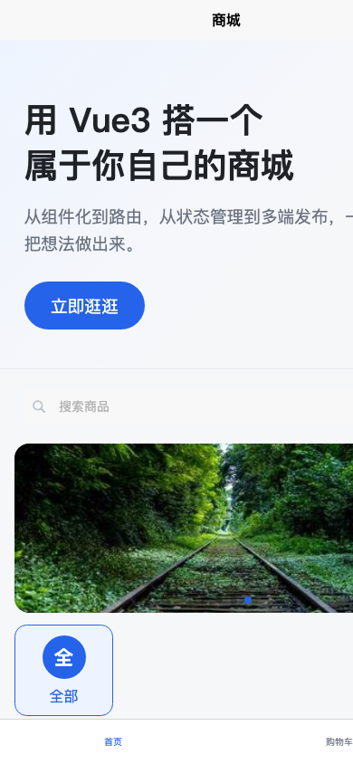

# mall-app

> uni-app 多端商城客户端。作品集总入口在 `mall-web` 仓库：[PORTFOLIO.md](https://github.com/ndotsc/mall-web/blob/main/PORTFOLIO.md)（GitHub 代码仓库链接，未联网验证、**非部署地址**）。


> 上面是 CI badge / 代码仓库信息，**未联网验证、不是部署地址**。

## 1. 定位

`mall-app` 是「前端全栈 4 周冲刺」里的项目 B：一套 Vue 3 代码通过 uni-app 编译到 **H5 / 微信小程序 / Android App**，覆盖浏览、搜索筛选、商品详情、购物车、地址、下单、订单、收藏、优惠券与个人中心。它与 `mall-web`（Vue 3 桌面网站）共用同一套后端接口，可切换 Node / Go / PHP 三套兼容实现。

## 2. 技术栈

| 层 | 选型 |
|---|---|
| 框架 | uni-app Vue 3、Pinia |
| 多端 | H5、微信小程序、Android App（HBuilderX 云打包） |
| 构建 | `@dcloudio/vite-plugin-uni`、Vite 5、Sass |
| HTTP | `uni.request` 封装，统一 `{ code, message, data }`、401 refresh 轮换 |
| 包管理 | **npm**（本仓库是 `package-lock.json`；`mall-web` 才是 pnpm） |
| H5 路由 | **hash 模式**，见 `src/manifest.json` |
| 后端 | `mall-api` 3000 / `mall-api-go` 3002 / `mall-api-php` 3001，任选其一 |

## 3. 功能清单

- 首页：搜索、Banner、分类宫格、商品流、下拉刷新 / 触底加载。
- 商品：分类筛选、列表、详情、轮播、图文详情、SKU 入口、收藏、评价。
- 交易：购物车勾选 / 改量 / 金额计算、地址管理、确认订单、优惠券、订单列表 / 详情、状态展示。
- 用户：登录 / 注册、我的、我的收藏、领券中心、我的优惠券。
- 多端：H5 公众号一键登录入口、微信小程序 `wx.login` / openid 登录入口、App 安全区与 manifest 配置。
- 体验：图片懒加载 / 失败兜底、骨架屏、公开 GET 缓存、错误态重试、App 级异常兜底、H5 静态 meta。

## 4. 架构与目录

```
mall-app/
├── index.html                # H5 静态 meta（保留 uni-app viewport 脚本）
├── public/
│   ├── robots.txt
│   └── sitemap.xml
├── docs/screenshots/         # D27 真实页面截图
├── src/
│   ├── api/                  # 业务接口封装
│   ├── components/           # smart-image / page-skeleton / error-state（easycom 自动引入）
│   ├── pages/                # index / detail / cart / confirm / order / mine / favorite / coupon ...
│   ├── stores/               # Pinia：user / cart / address / order
│   ├── utils/                # request.js、image.js
│   ├── pages.json            # 路由、窗口样式、easycom、下拉刷新
│   ├── manifest.json         # AppID、H5 hash 路由、各端配置
│   ├── App.vue               # App 级 onError / onUnhandledRejection / onPageNotFound
│   └── main.js               # 全局 errorHandler
└── package.json
```

`src/utils/request.js` 基址默认 `http://localhost:3000/api`，可用 `.env` 的 `VITE_API_BASE` 切换三套后端。小程序真机 / 线上 H5 必须使用 https 域名并配置 request 合法域名。

## 5. 本地运行

> 命令只列给你自己执行；D27 没有代跑安装 / 构建 / 测试。

```bash
cd /Users/baichuan/development/projects/frontend/uni-app/mall-app
npm install
npm run dev:h5          # H5 开发服务器
npm run dev:mp-weixin   # 编译到 dist/dev/mp-weixin，用微信开发者工具导入
npm run build:h5        # dist/build/h5
npm run build:mp-weixin # dist/build/mp-weixin
```

接口配置：

```bash
cp .env.example .env
# 改 VITE_API_BASE，例如 http://localhost:3002/api（Go）或 http://localhost:3001/api（PHP）
```

微信小程序首次导入：开发者工具 → 导入项目 → 选 `dist/dev/mp-weixin`；本地调试需在「设置 → 项目设置」勾选「不校验合法域名」。

## 6. 接口与契约

- 统一响应：成功 `{ code: 0, message: "ok", data: ... }`，失败 `{ code: <HTTP状态码>, message: "...", data: null }`。
- 请求必须用 `uni.request`：小程序环境没有 `XMLHttpRequest`，axios 在端上跑不起来。
- 金额：接口给「分」，展示时 `/100` 转元，不在前端重算价格。
- 鉴权：access / refresh 双令牌；401 时若有 refreshToken 会静默换发并重试一次，`_retry` 防递归。
- 图片：库内存 `/uploads/xxx.png`，接口返回完整 URL；三套后端共用 `backend/uploads/`；完整契约见 `mall-web/PORTFOLIO.md` 第 1 节。
- 完整接口清单：`mall-api/API.md` 或 `GET /api/docs`。

## 7. 部署地址（当前未部署）

> 用户已确认不部署到线上；下表按「未部署 / 待补」降级交付，零编造 URL。

| 字段 | 地址 | 状态 | 来源 |
|---|---|---|---|
| Web 桌面网站 | 待填 | 当前未部署 | 用户提供或自行部署后回填 |
| H5 商城 | 待填 | 当前未部署 | 用户提供或自行部署后回填 |
| API · Node | 待填（本地 `http://localhost:3000/api`） | 当前未部署 | 用户提供或自行部署后回填 |
| API · Go | 待填（本地 `http://localhost:3002/api`） | 当前未部署 | 用户提供或自行部署后回填 |
| API · PHP | 待填（本地 `http://localhost:3001/api`） | 当前未部署 | 用户提供或自行部署后回填 |
| 微信小程序 | 待填 | 当前未部署 / 未提交审核 | 用户提供或自行部署后回填 |
| Android APK | 待填 | 当前未部署 / 未打包分发 | 用户提供或自行部署后回填 |
| 代码仓库 | `https://github.com/ndotsc/mall-app`（未联网验证） | **不是部署地址** | 现有 badge |

`robots.txt` / `sitemap.xml` 中的 `https://example.com` 仍是占位；`index.html` 只有注释提到占位、没有绝对 URL。拿到真实域名后按 `mall-web/PORTFOLIO.md` 第 5 节的 18 点清单一次性回填。**不要全局替换后端契约示例。**

## 8. 截图

用户确认截图放前端仓库、无需打码。本轮已在本机启动 H5 dev server 并用无头 Chrome 抓取真实页面：

| 页面 | 文件 |
|---|---|
| H5 首页 | [app-h5-home.png](./docs/screenshots/app-h5-home.png) |
| H5 商品详情 | [app-h5-detail.png](./docs/screenshots/app-h5-detail.png) |



购物车、确认订单、我的、订单、微信小程序、Android App 等截图列入 `mall-web/PORTFOLIO.md` 第 4 节「待补截图清单」，由用户本地启动后补图。

## 9. D26 体验优化摘要

| 项 | 实现 |
|---|---|
| 图片 | `smart-image` 根节点就是 `<image>`，9 处替换保留父级 class / style；小程序 `lazy-load` / `webp`，失败切 `/static/logo.png` |
| 图片 URL | `imageUrl()` 预留 CDN 尺寸 / 格式参数；后端已返回完整 URL |
| 骨架屏 | `page-skeleton` 的 list / grid 形状，rpx 单位，替换多处「加载中…」 |
| 接口缓存 | `src/utils/request.js` 白名单只放公开 GET；TTL 60s；同 key 并发复用同一个 Promise；写操作清缓存；缓存只在内存 |
| 错误兜底 | `main.js` 全局 errorHandler + `App.vue` 的 `onError` / `onUnhandledRejection` / `onPageNotFound`；首页区分请求失败与空数据并给重试 |
| H5 SEO | 静态 meta / OG / theme-color；`manifest.json` 显式 hash 路由；`robots.txt` / `sitemap.xml`；收藏页补 `enablePullDownRefresh` |

## 10. 已知边界

- H5 是 hash 路由 SPA，**不能改成 history**：`login.vue` 公众号回调里拼了 `#/pages/login/login`。
- 爬虫只能看到静态 meta 与空容器；商品详情等内页进 sitemap 需要 SSR / 预渲染。
- 小程序端还没做 `subPackages` 分包与 CDN 图片域名；主包约 412K，真机仍依赖「不校验合法域名」。
- 个人主体小程序不能开微信支付，商城下单是模拟下单 / 货到付款闭环。
- 服务端图片重编码、HTTP 缓存头、Redis 共享缓存属于 `mall-web/RETROSPECTIVE.md` 的进阶路线，当前未实现。

## 11. 关联导航

| 目标 | 链接 / 路径 | 状态 |
|---|---|---|
| 作品集总览 | `https://github.com/ndotsc/mall-web/blob/main/PORTFOLIO.md` | 跨仓库 GitHub 绝对链接，未联网验证、非部署地址 |
| 复盘与路线 | `https://github.com/ndotsc/mall-web/blob/main/RETROSPECTIVE.md` | 同上 |
| mall-web | `https://github.com/ndotsc/mall-web` | 代码仓库，未联网验证、非部署地址 |
| mall-api | `https://github.com/ndotsc/mall-api` | 同上 |
| mall-api-go | 待补（来源：用户提供） | 不按组织名推测 |
| mall-api-php | 待补（来源：用户提供） | 不按组织名推测 |
| 后端本地总览 | `backend/README.md` | 不在任何 Git 仓库内，仅本地可读 |

## 12. 与 mall-web 的关系

`mall-web` 是桌面 / 移动浏览器版（Vue 3 + Element Plus，pnpm），`mall-app` 是多端版（uni-app，npm）。两者共用同一套后端接口；三套后端平级放在 `backend/` 下，切换只改 `VITE_API_BASE`。D27 作品集总入口放在 `mall-web/PORTFOLIO.md`，本仓库通过上面的跨仓库链接回链。
